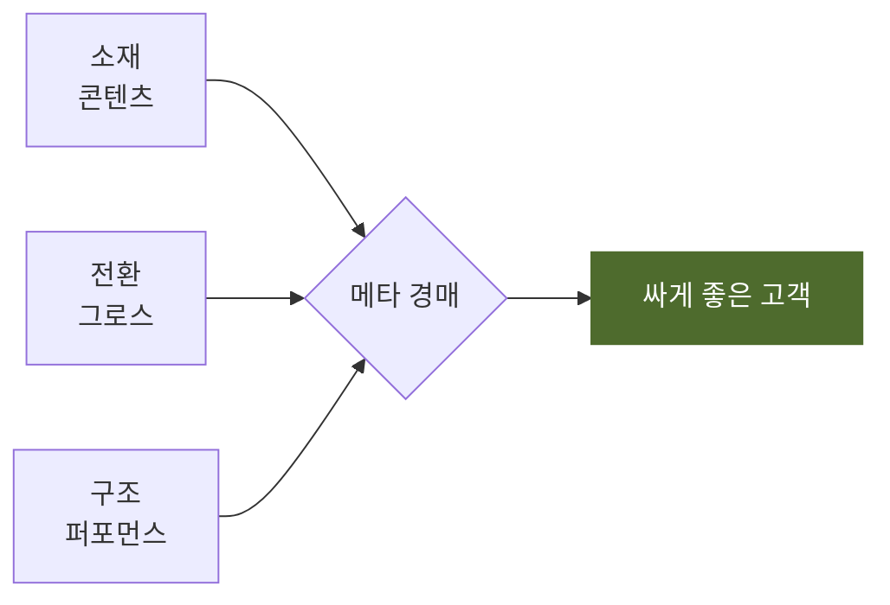

# 도식화 — 복잡한 것은 글 대신 그림으로 (정본 v1 · 2026-10-13)

출처: Temikus/claude-skill-infographics(보고서 페이지 원칙 — 리드·대표 숫자·발견 제목·질문별 차트), SpillwaveSolutions/design-doc-mermaid(Mermaid 규칙 — 검증 뒤 삽입, PDF는 그림으로), fleurytian mckinsey-consultant(논점식 제목·한 쪽 한 메시지·그림이 쪽의 60% 이상). 셋을 우리 양식에 맞게 줄였다.

## 1. 언제 그림으로 바꾸나

글로 쓰면 세 문장이 넘는 아래 다섯 가지는 그림으로 바꾼다. 그림은 글을 **대신**한다. 글을 그대로 두고 그림을 더하지 않는다.

| 내용 | 그림 | Mermaid 종류 |
|---|---|---|
| 흐름 · 순서 · 단계 (A 다음 B, 누가 누구에게 넘기나) | 흐름도 | `flowchart LR` |
| 구조 · 구성 (무엇이 무엇으로 이뤄지나, 상·하위) | 구조도 | `flowchart TD` |
| 판단 · 분기 (이러면 저리, 아니면 이리) | 결정 나무 | `flowchart TD` + `{ }` 마름모 |
| 일정 (날짜별 마일스톤) | 타임라인 | `timeline` |
| 두 축 비교 (중요도 × 긴급도, 비용 × 효과) | 2×2 | `quadrantChart` |

숫자 비교는 그림이 아니라 **표**다. 추이 · 비중은 차트(아래 5절). 두 가지를 한 그림에 섞지 않는다.

## 2. 그림 규칙 여섯

1. **그림 하나에 메시지 하나.** 두 가지를 말하려면 두 그림.
2. **제목은 발견이다.** "퍼널 진단 순서"가 아니라 "숫자가 나쁠 때 CPM → 훅 → 본문 → 오퍼 순서로 본다". 그림 바로 아래 기울임 한 줄로 쓴다: `*그림 1. 숫자가 나쁠 때 보는 순서.*`
3. **상자 7개 안쪽, 글자 6자 안쪽.** 넘치면 그림을 나누거나 묶음 상자(`subgraph`)로 접는다.
4. **색은 하나.** 기본은 연녹색. 강조할 상자 하나만 `style X fill:#4e6b2d,color:#fff`. 빨강 · 파랑 · 노랑을 섞지 않는다.
5. **글자 방향.** 흐름은 왼쪽 → 오른쪽(`LR`), 구조는 위 → 아래(`TD`). 화살표에 글을 달 때는 3어절 안쪽.
6. **검증 뒤 삽입.** 변환기가 "도식 n개 중 m개만 그려졌습니다"라고 하면 그 그림은 문서에 들어간 게 아니다. https://mermaid.live 에서 고친다. 우리말 · 줄바꿈(`<br/>`) · 괄호는 상자 글을 `"..."`로 감싼다.

## 3. 쓰는 법

MD 안에 코드 블록으로 쓴다. 변환기가 PDF에서 그림으로 바꾸고, ERP 위키 화면도 그린다.

````


*그림 1. 세 신호가 하나로 맞아야 경매에서 싸게 이긴다.*
````

### 본보기 넷

흐름(누가 누구에게 넘기나):
```
flowchart LR
  P["퍼포먼스<br/>소재별 숫자"] -->|"월 · 목"| C["콘텐츠<br/>차기 소재"]
  C -->|"데뷔 소재"| P
  G["그로스<br/>오퍼 · 랜딩"] -->|"브리프"| C
```

판단 분기:
```
flowchart TD
  S["ROAS가 떨어졌다"] --> Q1{"CPM이<br/>50% 넘게 뛰었나"}
  Q1 -->|예| A["문구 · 오퍼 점검<br/>(퍼포먼스 · 그로스)"]
  Q1 -->|아니오| Q2{"Thumbstop<br/>20% 미만"}
  Q2 -->|예| B["훅 교체<br/>(콘텐츠)"]
  Q2 -->|아니오| Q3{"Hold<br/>20% 미만"}
  Q3 -->|예| C2["본문 교체<br/>(콘텐츠)"]
  Q3 -->|아니오| D["랜딩 · 오퍼<br/>(그로스)"]
```

일정:
```
timeline
  title 영양공백 프로젝트
  10/14 : 결정
  10/17 : 기획안 2개
  10/21 : 대표 촬영
  11/5 : 현미오트링 적용
  11/19 : 단백팝 적용
```

구조(묶음 상자):
```
flowchart TD
  subgraph 캠페인 5개
    T["테스트 1<br/>예산 25%"] --> X["확장 1"]
    R["리타겟 1"]
    D1["단백팝 신규"] 
    D2["단백팝 기존 고객"]
  end
```

## 4. 쪽 배치 (맥킨지식)

- 그림이 들어간 꼭지는 **제목(발견) → 그림 → 설명 한 줄 → 표 또는 세 줄 불릿** 순서. 그림이 쪽의 절반 이상을 차지해도 된다. 작은 그림을 구석에 두지 않는다.
- 그림은 쪽을 넘지 않는다(변환기가 자동으로 통째로 넘긴다). 그림 뒤에 빈 공간이 크면 그림을 줄이지 말고 앞 문단을 옮긴다.
- 한 쪽에 그림은 둘 안쪽.

## 5. 숫자는 어떤 모양으로 (질문별)

| 묻는 것 | 모양 | 비고 |
|---|---|---|
| 숫자 하나가 얼마인가 | 숫자 블록 — 큰 숫자 + 비교(전월 · 목표) 한 줄 | 막대 하나짜리 차트 · 조각 둘짜리 원그래프 금지 |
| 무엇이 큰가 | 가로 막대, 큰 순 정렬, 값 표시 | 위 하나만 색, 나머지 회색 |
| 어떻게 이 숫자가 됐나 | 폭포(시작 → 더하고 빼고 → 끝) | 가격 · 공헌이익 분해 |
| 추세 | 선, 마지막 점 표시, 목표선 점선 | 축 최소화 |
| 둘을 비교 | 같은 축 · 같은 크기 나란히 | 한 그림 크고 한 그림 작게 금지 |
| 여러 항목 × 여러 기간 | 표 | 차트로 억지로 만들지 않는다 |

차트는 아직 변환기가 그리지 않는다. 숫자 블록과 표로 쓰고, 꼭 차트가 필요하면 PNG로 그려 ``로 넣는다(변환기가 파일째 심는다).

## 6. 검사

- [ ] 글로 세 문장 넘는 흐름 · 구조 · 분기 · 일정이 아직 글로 남아 있지 않은가
- [ ] 그림마다 아래에 `*그림 n. 발견.*` 한 줄이 있는가
- [ ] 상자 7개 · 색 하나 · 메시지 하나인가
- [ ] 변환기 출력에 "도식 n개"가 찍히고 "m개만 그려졌습니다" 경고가 없는가
