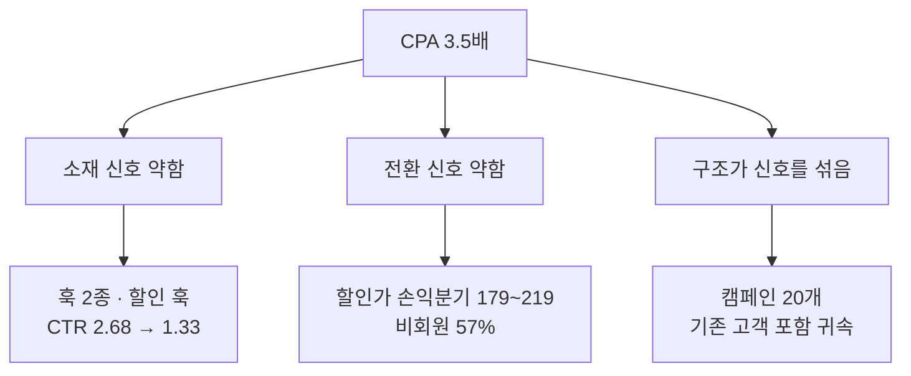

# 구조 — 나열이 아니라 문제 진단 → 원인 → 해결 → 결정 (정본 v1 · 2026-10-13)

출처: millwright-labs/minto-pyramid-skill(80★ · 답 먼저 → 이유 묶음 → 근거, SCQA, "셋에 맞추지 않는다", 지어내지 않는다), tyroneross/pyramid-principle(문제해결 메모 · 결정 브리프 뼈대, 제목은 주장문, 흔한 위반 10가지), fleurytian mckinsey-consultant(문제 정의 "다루는 것 · 다루지 않는 것", 원인 나무 MECE, 가설). 바바라 민토 『논리의 기술』이 원전이다. 셋을 우리 양식에 맞게 줄였다.

## 1. 왜 나열식이 되나

사실을 모은 순서대로 쓰면 나열이 된다. 읽는 사람은 "그래서 뭘 하라는 거냐"를 마지막까지 모른다. 보고서는 **읽는 사람의 질문 하나에 답하는 글**이다. 질문이 "왜 이렇고, 뭘 해야 하나"면 구조는 문제 → 원인 → 해결 → 결정이어야 한다. 현황 · 지표 · 사례 · 계획을 차례로 늘어놓는 글은 답이 없다.

## 2. 쓰기 전에 네 줄을 먼저 적는다

보고서를 쓰기 전에 아래 넷을 한 줄씩 적는다. 넷 중 하나라도 못 적으면 아직 쓸 때가 아니다.

| 줄 | 적는 것 | 본보기 |
|---|---|---|
| 읽는 사람의 질문 | 이 문서가 답해야 할 질문 하나 | "광고 효율이 왜 떨어졌고, 뭘 바꿔야 하나" |
| 답 (핵심 주장) | 질문에 대한 답 한 문장. 반박할 수 있을 만큼 구체적으로 | "세 신호가 따로 놀아 CPA가 3.5배 됐다. 소재 · 오퍼 · 구조를 함께 바꾼다" |
| 이유 묶음 | 답을 받치는 이유 2~4개. 같은 종류의 이유만, 겹치지 않게, 빠진 것 없이 | 소재 신호 약함 · 전환 신호 약함 · 구조가 신호를 섞음 |
| 다루지 않는 것 | 이 문서에서 일부러 뺀 것 | 고정비 · 쿠팡 채널 · 채용 |

이유는 셋에 맞추지 않는다. 둘이 다 설명하면 둘, 넷이 필요하면 넷. 하나가 다른 하나의 세부면 그건 이유가 아니라 근거다.

## 3. 도입은 SCQA로 — 「왜 썼고, 어떻게 읽나」의 첫 문단

| 요소 | 뜻 | 분량 |
|---|---|---|
| S 상황 | 읽는 사람이 이미 아는 것 | 한 문장 |
| C 문제 | 무엇이 바뀌었나 · 깨졌나. 이게 없으면 읽는 사람에게 질문이 생기지 않는다 | 한두 문장, 숫자 하나 |
| Q 질문 | 그래서 생기는 질문 (보통 생략) | — |
| A 답 | 핵심 주장 | 한 문장 |

본보기: "1월 CPA 5,126원으로 광고를 돌렸다(S). 9월 18,205원, 3.5배가 됐고 지금 방식이면 4분기에 손익분기에 닿는다(C). 원인은 소재 · 전환 · 구조 세 신호가 따로 노는 것이고, 셋을 함께 바꾸면 12월 CPA 14,000원으로 돌아갈 수 있다(A)."

## 4. 본문 뼈대 셋 — 질문에 따라 고른다

### 뼈대 A. 문제해결 보고서 — 질문이 "왜 이렇고 뭘 해야 하나"

```
1. 문제   — 무엇이 얼마나 나쁜가 (숫자, 기간, 돈으로 환산)
2. 원인   — 원인 나무: 같은 층은 같은 종류 · 겹치지 않게 · 빠짐없이. 원인마다 근거 한 줄
3. 해결   — 원인마다 대응. 갈림길이 있으면 선택지 2~3개를 같은 기준으로 비교한 뒤 권고
4. 실행   — 누가 · 무엇을 · 언제까지. 첫 행동 하나
5. 리스크 — 안 되면 어떻게 아는가, 되돌리는 법
6. 정할 것 — 예/아니오 질문. 안 하면 어떻게 되는지 한 줄
```

### 뼈대 B. 결정 브리프 — 질문이 "뭘 고를까"

```
1. 권고   — 무엇을 고르자, 왜 (한 문단)
2. 이유   — 2~4개, 같은 종류
3. 선택지 비교 — 같은 기준(돈 · 기간 · 위험 · 되돌리기)으로 표 하나
4. 리스크와 대응
5. 결정 뒤 첫 행동 — 누가 언제
```

### 뼈대 C. 분석 · 현황 보고서 — 질문이 "무슨 일이 일어나고 있나" (결정 없음)

```
1. 발견 1 (가장 큰 것부터) — 근거
2. 발견 2 — 근거
3. 발견 3 — 근거
4. 이 발견이 우리에게 뜻하는 것 — 2~3줄
```

현황 · 지표 · 일정 · 사례 같은 자료는 뼈대의 어느 칸을 받치는 근거로 들어간다. 자료 자체가 장이 되면 나열이다. 어느 칸도 받치지 않는 자료는 부록으로 보내거나 지운다.

## 5. 제목은 주장문이다

장 · 절 제목은 "무엇에 관한 것"이 아니라 "무엇이 어떻다"로 쓴다. 제목만 읽어도 줄거리가 보여야 한다. 같은 층의 제목은 같은 꼴로 맞춘다.

| 주제 제목 (금지) | 주장 제목 (이렇게) |
|---|---|
| 1. 지금 숫자 | 1. 주문당 광고비가 1월의 3.5배가 됐고 손익분기 턱밑이다 |
| 2. 메타 경매 | 2. 원인은 소재 · 전환 · 구조 세 신호가 따로 놀기 때문이다 |
| 4. 콘텐츠팀 지표 | 4. 콘텐츠는 ROAS가 아니라 Thumbstop · Hold · CTR을 본다 |
| 원인 분석 | 원인의 절반은 소재 훅이 할인으로 바뀐 것이다 |

## 6. 원인 나무 — 그림으로

원인은 글로 늘어놓지 말고 나무로 그린다(규칙 15). 1층은 같은 종류(예: 신호 셋), 2층은 각 1층의 세부. 원인마다 근거 숫자 하나를 상자 안이나 옆 표에 둔다.



## 7. 흔한 위반 — 이게 보이면 나열식이다

| 위반 | 모양 | 고치는 법 |
|---|---|---|
| 주제로 여는 글 | "이 문서는 현황 · 지표 · 계획을 다룹니다" | 첫 문단을 SCQA로. 답을 먼저 |
| 문제(C)가 없다 | 상황 → 바로 제안 | 무엇이 바뀌었는지 숫자 하나로 넣는다 |
| 답이 묻혀 있다 | 두 쪽 뒤 "결론적으로" | 답을 첫 문단으로 올린다 |
| 다른 종류 섞인 묶음 | 이유 1 사실, 이유 2 일정, 이유 3 위험 | 묶음이 답하는 질문 하나를 정하고 그 질문에 답하는 것만 남긴다 |
| 겹치는 이유 | "온보딩 부족" + "초기 지원 부족" | 하나로 합치거나 층을 나눈다 |
| 자료가 장이 됐다 | "3. 지표 정의", "5. 사례" | 그 자료가 받치는 주장 아래로 옮긴다 |
| 해결이 원인과 안 맞는다 | 원인은 소재인데 해결은 예산 | 원인마다 대응을 한 줄씩 짝지어 표로 |
| 선택지 없이 권고 | "이렇게 하자"만 | 갈림길이면 선택지 2~3개를 같은 기준으로 비교한 표를 앞에 |
| 리스크 · 다음 할 일 삭제 | 이유가 아니라서 뺌 | 끝에 자리를 준다. 결정을 바꿀 만한 리스크는 답 옆에 |
| 없던 숫자가 생김 | 원문에 없는 계산 · 추정 | 지어내지 않는다. 출처 없으면 "확인 필요" |

## 8. 검사 — 쓰고 나서

- [ ] 첫 문단에 S · C · A가 있고, 답이 문서의 10% 안에 나오는가
- [ ] 제목만 읽어도 문제 → 원인 → 해결 → 결정 줄거리가 보이는가 (주제 제목 0개)
- [ ] 이유 묶음이 같은 종류 · 겹침 없음 · 빠짐 없음인가
- [ ] 원인마다 대응이 하나씩 짝지어져 있는가
- [ ] 자료만 있는 장이 없는가 (있으면 부록으로)
- [ ] 리스크 · 다음 할 일 · 정할 것이 끝에 있는가
