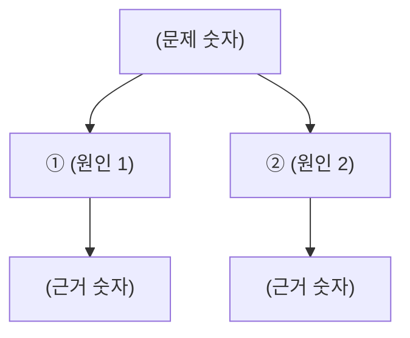

# (제목 — 명사구 하나. 예: 9월 자사몰 광고 효율 보고서)

2026. 0. 0.(요일) · 작성 ○○○ · 수신 ○○○ · 결정 필요: 아니오

## 이 문서는 왜 썼고, 어떻게 읽나

(두 장 넘는 보고서와 회의 자료만. 한 장짜리는 이 섹션을 지운다.)

**왜 썼나.** (무엇이 어떻게 달라져서 썼는지 두세 문장. 숫자 하나로 시작한다.)

**요지 세 줄.**
1. (바꾸는 판단 기준)
2. (바꾸는 일하는 방식)
3. (그래서 얻는 것)

**목표.** (언제까지 어떤 숫자를 어디서 어디로. 셋 안쪽.)

**누가 어떻게 읽나.**

| 읽는 사람 | 읽으면서 할 판단 | 먼저 볼 곳 | 정할 것 |
|---|---|---|---|
| (결정하는 사람, 이름) | (이 문서를 읽고 답해야 할 질문) | (장 번호) | (결정 번호) |
| (판단하는 사람, 이름) | (자기 파트에서 무엇을 바꿀지) | (장 번호) | (결정 번호) |

읽는 순서는 결론 → 용어 설명 → 자기 파트 장 → 정할 것입니다.

## 결론

**지금 상태**

- (사실 1. 숫자 하나. 꼭 기억할 숫자는 <mark>형광</mark>, 판단은 **굵게**.)
- (사실 2.)

**바꾸는 것**

- (무엇을 → 무엇으로. 한 줄.)
- (무엇을 → 무엇으로.)

**정할 것 N건(○장).** (묶음별 건수.)

## 용어 설명 — 모르는 단어가 없게

(숫자가 나오는 보고서만. 읽는 사람 열에 여덟이 모를 말은 전부 적는다. 약자는 원어와 우리말을 함께. 뒤의 표와 본문은 이 순서를 따른다. 길면 묶음(돈 · 광고 · 소재 …)으로 나눠 표 하나가 한 쪽을 넘지 않게 한다.)

| 용어 | 쉬운 말 | 지금 값 |
|---|---|---:|
| | | |

## 1. 문제 — (무엇이 얼마나 나쁜가를 주장문으로. 예: 주문당 광고비가 1월의 3.5배가 됐다)

(숫자 · 기간 · 돈으로 환산. 표 하나.)

## 2. 원인 — (원인을 한 문장으로. 예: 세 신호가 따로 놀기 때문이다)

(원인 나무. 1층은 같은 종류 · 겹침 없음 · 빠짐 없음. 원인마다 근거 한 줄.)

*그림 1. (원인 나무가 말하는 것 한 줄.)*

| 원인 | 무엇이 바뀌었나 | 근거 | 해결(3장) |
|---|---|---|---|
| ① | | | |
| ② | | | |

## 3. 해결 — (해결 방향을 한 문장으로)

(원인마다 대응 하나. 갈림길이 있으면 선택지 2~3개를 같은 기준(돈 · 기간 · 위험 · 되돌리기)으로 표 하나에 비교한 뒤 권고.)

| 원인 | 대응 | 누가 |
|---|---|---|
| ① | | |
| ② | | |

## 4. 실행 — (누가 언제까지)

(흐름 · 일정은 글 대신 그림으로.)

## 5. 리스크 — (안 되면 어떻게 아는가)

(되돌리는 법 한 줄.)

## 6. 정할 것

1. (예/아니오로 답할 수 있게 한 줄. 안 하면 어떻게 되는지 한 줄.)

(분석 · 현황 보고(결정 없음)는 1~3 대신 「발견 1 · 2 · 3 → 뜻하는 것」. 뼈대 셋은 structure.md.)

## 다음 할 일

| 누가 | 무엇 | 언제까지 |
|---|---|---|
| | | |

## 출처·신뢰도

(숫자의 출처와 기간. 추정이 섞인 곳은 "추정"이라고 적는다.)
